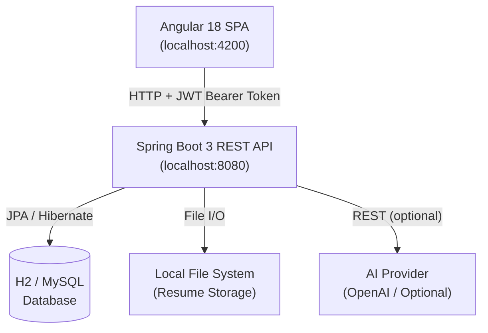
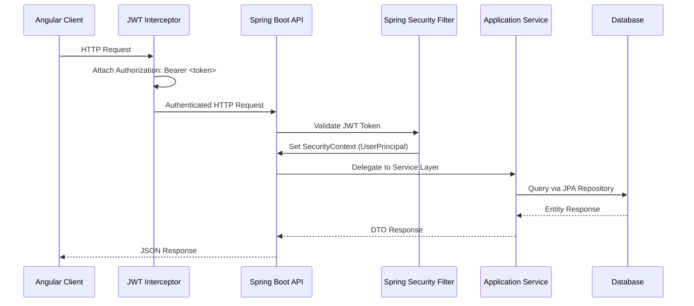
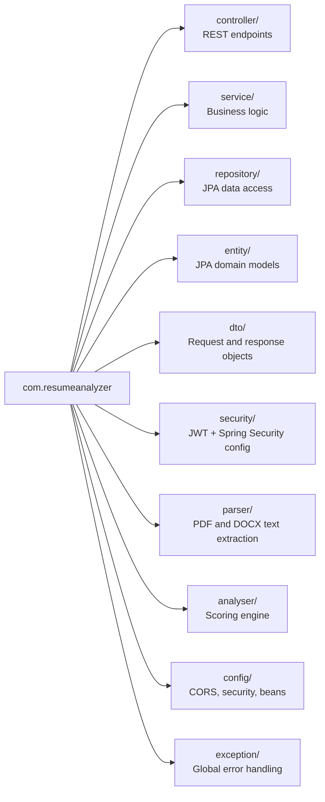
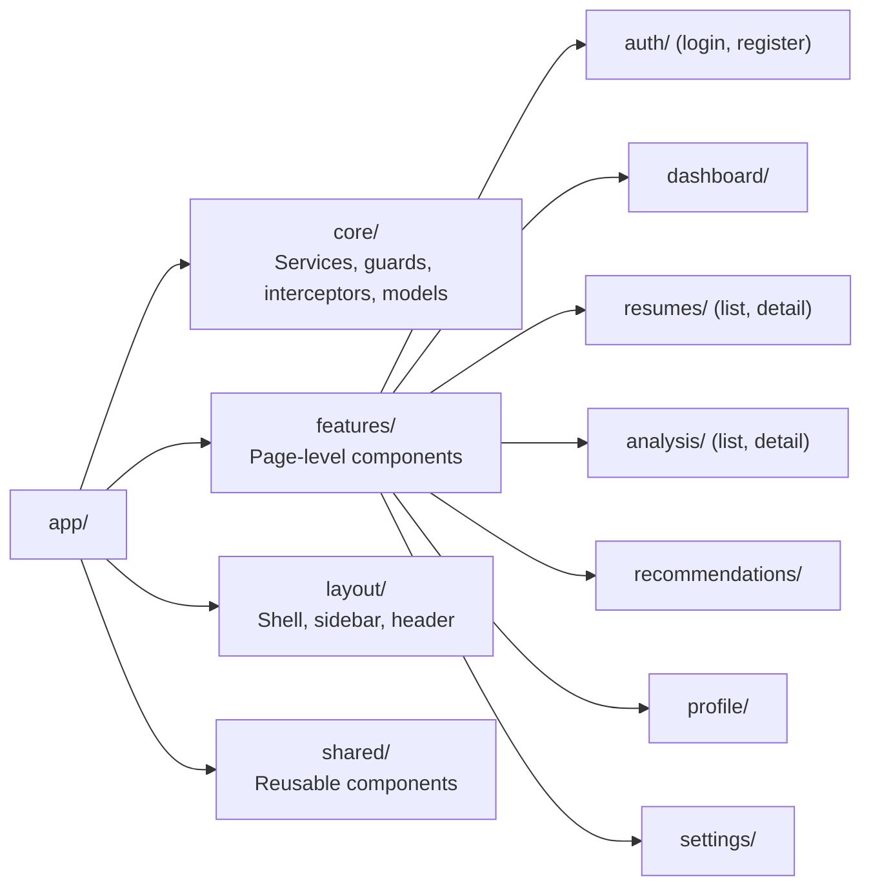

# ATSense: Resume Analyzer

A full-stack web application for parsing, evaluating, and scoring candidate resumes against ATS (Applicant Tracking System) criteria. Built with a Spring Boot REST backend and an Angular 18 frontend, the platform provides structured section-by-section feedback and a multi-dimensional scoring model to help candidates improve their documents for modern hiring pipelines.

---

## Table of Contents

- [Project Overview](#project-overview)
- [Architecture](#architecture)
- [Feature Set](#feature-set)
- [Technology Stack](#technology-stack)
- [API Reference](#api-reference)
- [Frontend-Backend Communication](#frontend-backend-communication)
- [Setup and Usage](#setup-and-usage)
- [Environment Variables](#environment-variables)

---

## Project Overview

Resume Analyzer accepts PDF and DOCX documents, extracts their text content using Apache PDFBox and Apache POI, and evaluates the extracted content across seven scoring dimensions: ATS optimization, content quality, structure, skills, experience, education, and projects. Each evaluation produces a numerical overall score (0-100), dimension sub-scores, per-section textual feedback, and a prioritized list of improvement recommendations.

Users authenticate via JWT-secured endpoints, and all resume data and analysis history are persisted per account. The platform supports both a deterministic rule-based scoring engine and an optional AI-assisted mode configurable at the application level.

---

## Architecture

### System Overview



### Request Lifecycle



### Backend Package Structure



### Frontend Module Structure



---

## Project Structure

```text
ATSense/
├── backend/
│   ├── src/
│   │   ├── main/
│   │   │   ├── java/com/resumeanalyzer/
│   │   │   │   ├── analyser/
│   │   │   │   ├── config/
│   │   │   │   ├── controller/
│   │   │   │   ├── dto/
│   │   │   │   ├── entity/
│   │   │   │   ├── exception/
│   │   │   │   ├── parser/
│   │   │   │   ├── repository/
│   │   │   │   ├── security/
│   │   │   │   └── service/
│   │   │   └── resources/
│   │   │       └── db/migration/
│   │   └── test/
│   └── pom.xml
│
├── frontend/
│   ├── public/
│   ├── src/
│   │   ├── app/
│   │   │   ├── core/
│   │   │   ├── features/
│   │   │   ├── layout/
│   │   │   └── shared/
│   │   └── environments/
│   └── package.json
│
└── README.md
```


## Feature Set

**Authentication**
- User registration with email, username, and password
- JWT-based login with 24-hour token expiry
- Automatic token injection on all authenticated requests via Angular HTTP interceptor
- Route guards preventing unauthenticated access to protected views

**Resume Management**
- Upload PDF and DOCX files up to 10 MB via multipart form
- Automatic text extraction at upload time
- Paginated file list with format badge, size, and upload timestamp
- Per-file detail view showing raw extracted text and evaluation history
- File deletion with cascading removal of associated analyses

**Resume Analysis**
- Trigger evaluation per resume on demand
- 7-dimension scoring: ATS optimization, content quality, structure, skills, experience, education, projects
- Aggregated overall score (weighted average, 0-100)
- Per-section textual feedback identifying strengths and deficiencies
- Prioritized recommendation list (HIGH / MEDIUM / LOW) with category tagging

**Dashboard**
- Summary statistics: total resumes, total analyses, average score, best score
- Recent resumes table with inline analysis trigger
- Analysis history list with per-entry score and ATS percentage

**Recommendations**
- Aggregated view of recommendations across all analyses
- Filter by priority level and category

**Profile and Settings**
- Update display username
- Toggle between dark and light interface mode

---

## Technology Stack

| Layer | Technology |
|---|---|
| Backend language | Java 21 |
| Backend framework | Spring Boot 3.3.5 |
| Security | Spring Security 6, JJWT (JWT) |
| Data persistence | Spring Data JPA, Hibernate |
| Database (default) | H2 in-memory (dev), configurable for MySQL |
| Schema migration | Flyway |
| PDF parsing | Apache PDFBox |
| DOCX parsing | Apache POI |
| Build tool | Maven |
| Frontend language | TypeScript |
| Frontend framework | Angular 18 (standalone components) |
| HTTP client | Angular HttpClient + RxJS |
| Styling | SCSS with custom CSS design system |
| Fonts | Inter (body), JetBrains Mono (monospace labels) |

---

## API Reference

All endpoints are prefixed with `/api`. Protected endpoints require the header `Authorization: Bearer <token>`.

### Authentication

| Method | Path | Auth | Description |
|---|---|---|---|
| POST | `/api/auth/register` | Public | Register a new user account |
| POST | `/api/auth/login` | Public | Authenticate and receive a JWT |

### Resumes

| Method | Path | Auth | Description |
|---|---|---|---|
| POST | `/api/resumes/upload` | Required | Upload a PDF or DOCX resume file |
| GET | `/api/resumes` | Required | List all resumes for the authenticated user |
| GET | `/api/resumes/{id}` | Required | Get resume detail including extracted text |
| DELETE | `/api/resumes/{id}` | Required | Delete a resume and its analyses |

### Analysis

| Method | Path | Auth | Description |
|---|---|---|---|
| POST | `/api/resumes/{id}/analyze` | Required | Run analysis on a specific resume |
| GET | `/api/resumes/{id}/analyses` | Required | List all analyses for a specific resume |
| GET | `/api/analyses` | Required | List all analyses for the authenticated user |
| GET | `/api/analyses/{id}` | Required | Get a specific analysis report |
| DELETE | `/api/analyses/{id}` | Required | Delete an analysis report |

### Dashboard and User

| Method | Path | Auth | Description |
|---|---|---|---|
| GET | `/api/dashboard/stats` | Required | Retrieve aggregate user statistics |
| GET | `/api/users/me` | Required | Get current user profile |
| PUT | `/api/users/me` | Required | Update current user profile |

---

## Frontend-Backend Communication

The Angular frontend communicates exclusively over HTTP with the Spring Boot REST API. The following mechanisms govern the integration:

**JWT Interceptor** (`core/interceptors/jwt.interceptor.ts`)

Every outgoing HTTP request passes through a functional interceptor that reads the stored JWT from `localStorage` and attaches it as an `Authorization: Bearer <token>` header. No request to a protected endpoint reaches the backend without this header.

**Auth Service** (`core/services/auth.service.ts`)

Maintains a `BehaviorSubject<User | null>` representing the current authenticated user. On login and registration, the returned token and user payload are persisted to `localStorage`. On logout, both values are cleared and the user is redirected to the login page.

**Resume Service** (`core/services/resume.service.ts`)

Wraps resume-related endpoints. The upload method constructs a `FormData` object with the file attached under the key `file`, matching the backend's `@RequestParam("file")` binding.

**Analysis Service** (`core/services/analysis.service.ts`)

Covers all analysis endpoints including trigger, history retrieval, single-report fetch, and deletion.

**Auth Guard** (`core/guards/auth.guard.ts`)

A functional route guard applied to all authenticated routes. Checks for a valid token via `AuthService`; unauthenticated users are redirected to `/login`.

**CORS Configuration**

The Spring Boot backend is configured to accept cross-origin requests from `http://localhost:4200` during local development.

---

## Setup and Usage

### Prerequisites

- Java 21
- Maven 3.9+
- Node.js 18+ and npm 9+
- Angular CLI 18 (or run via `npx`)

### Backend

```bash
git clone git@github.com:elel-m-b/ATSense.git
cd ATSense

# Run with the default development profile (H2 in-memory database)
mvn spring-boot:run

# The API will be available at http://localhost:8080
# H2 console available at http://localhost:8080/h2-console
```

### Frontend

```bash
cd ATSense/frontend

# Install dependencies
npm install

# Start the development server
npm start

# The application will be available at http://localhost:4200
```

### Full-Stack Development Workflow

1. Start the backend server on port 8080.
2. Start the Angular development server on port 4200.
3. Navigate to `http://localhost:4200` in a browser.
4. Register a new account or use the demo credentials on the login page.
5. Upload a PDF or DOCX resume file via the header button or the dashboard.
6. Navigate to the resume detail view and trigger analysis.
7. Review the score breakdown, section feedback, and recommendations in the analysis report.

---

## Environment Variables

### Backend

| Variable | Description | Default |
|---|---|---|
| `JWT_SECRET` | HMAC-SHA256 secret for signing tokens | Hardcoded development value (change for production) |
| `AI_API_KEY` | API key for the AI provider (OpenAI or compatible) | Empty (disables AI mode) |
| `AI_PROVIDER` | AI service provider identifier | `openai` |
| `AI_MODEL` | Model identifier for AI analysis | `gpt-4o-mini` |

### Frontend

The frontend API base URL is configured in `src/environments/environment.ts`:

```typescript
export const environment = {
  production: false,
  apiUrl: 'http://localhost:8080/api'
};
```

For production builds, update `environment.prod.ts` with the deployed backend URL.

---

## Production Considerations

- Replace the default JWT secret with a cryptographically random 256-bit value.
- Configure a persistent database (MySQL or PostgreSQL) via the Spring `application-prod.yml` profile.
- Set `AI_API_KEY` to enable AI-assisted analysis mode.
- Serve the Angular build artifacts (`dist/`) via Nginx or a cloud CDN.
- Configure CORS in `SecurityConfig` to allow only the production frontend domain.
