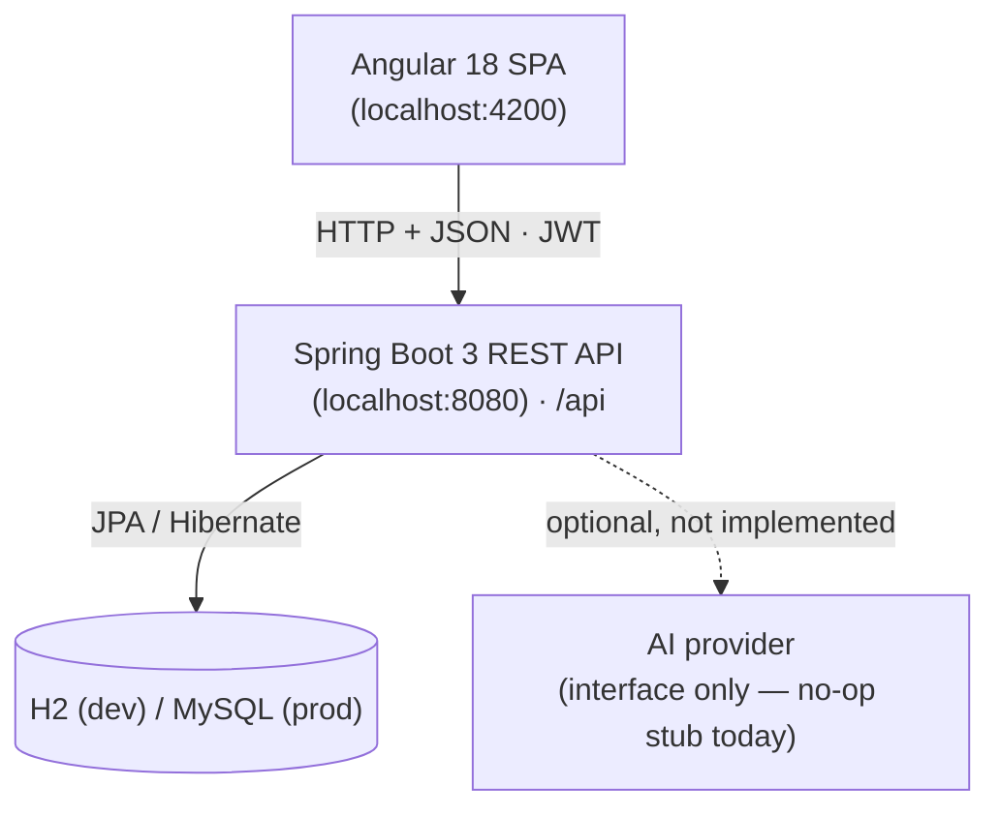

# CareerPilot

> Previously titled *"ATSense: Resume Analyzer"*. CareerPilot is the project's official name; some
> internal artifacts still use the historical `resume-analyzer` / `ResumeAnalyzer` naming.

**CareerPilot is a full-stack web application that scores a résumé the way an Applicant Tracking
System (ATS) does.** It extracts text from an uploaded PDF or DOCX, measures the document across
seven weighted dimensions, and returns a numeric score, per-section feedback and a prioritised list
of improvements.

Built with a **Spring Boot (Java 21)** REST backend and an **Angular 18** frontend, secured with JWT.

---

## Objectives

1. Explain the score — dimension breakdown and written feedback, not just a number.
2. Stay deterministic — identical input always produces the identical score.
3. Keep candidate data private — every résumé and analysis is owner-scoped.
4. Grow into a career toolkit **without breaking the existing ATS checker**.

---

## Current features (implemented)

- **Accounts & auth:** email/password registration and login, BCrypt hashing, stateless JWT, protected
  Angular routes.
- **Résumé management:** upload **PDF/DOCX** (max 10 MB), server-side extraction with Apache PDFBox
  and Apache POI, list, view (metadata + extracted text), delete.
- **Deterministic ATS analysis:** a **7-dimension** engine (ATS compatibility 20%, content quality
  20%, skills 15%, experience 20%, education 10%, projects 10%, structure 5%) producing an overall
  score, seven sub-scores, per-section feedback and prioritised recommendations
  (Critical / Important / Suggested).
- **Dashboard & history:** totals, average and best score; per-résumé and global analysis history; an
  aggregated recommendations page with priority/category filters.
- **Cross-cutting:** a standardised `ApiError {code, message, …}` contract, bean validation,
  owner-scoped data access, and CI that builds and tests both applications.

## Upcoming features (planned — **not yet available**)

> These come from [`CAREERPILOT_MIGRATION_PLAN.md`](CAREERPILOT_MIGRATION_PLAN.md) and are **not
> implemented**. They are listed so the direction is clear; do not rely on them today.

- Richer CV parsing (structured model, ~150-skill taxonomy, TXT support).
- Explainable **10-dimension** ATS engine with keywords, grades and career-stage awareness.
- CV **versioning** and re-scan against a target role or job ad.
- Persistent, status-tracked recommendations; candidate profile and a career-readiness dashboard.
- Companies/jobs catalog and a deterministic **job-matching** engine; application tracking.
- CV editor, ATS template and **PDF export**.
- **AI features (advanced):** job-description generator, interview-prep planner, RAG learning roadmap
  and an AI Career Copilot — each with an offline deterministic fallback.

See [`docs/FEATURE_ROADMAP.md`](docs/FEATURE_ROADMAP.md) for status, dependencies and acceptance
criteria per feature.

---

## Technology stack

| Layer | Technology |
| --- | --- |
| Frontend | **Angular 18** (standalone components), RxJS, SCSS, Karma/Jasmine |
| Backend | **Java 21**, **Spring Boot 3.3.5** (Web, Data JPA, Security, Validation), Maven |
| Security | Spring Security 6, JJWT 0.12.6, BCrypt |
| Database | **H2** in-memory (dev) / **MySQL** (prod) via Spring Data JPA + Hibernate |
| Migrations | Flyway (`V1__initial_schema.sql`, `V2__baseline_constraints.sql`) |
| Parsing | Apache PDFBox 3.0.3, Apache POI 5.3.0 |

The database technology was determined from the configuration, not assumed: `application-dev.yml`
(dev, H2) and `application-prod.yml` (prod, MySQL).

---

## High-level architecture



Full diagrams (system, frontend/backend layers, request/auth flows, deployment) are in
[`docs/ARCHITECTURE.md`](docs/ARCHITECTURE.md) and [`docs/UML_DIAGRAMS.md`](docs/UML_DIAGRAMS.md).

---

## Repository structure

```
CareerPilot/
├── backend/                    Spring Boot API
│   ├── pom.xml
│   └── src/main/java/com/resumeanalyzer/
│       ├── controller/  service/  repository/  entity/  dto/
│       ├── parser/      analyser/  security/    config/  exception/  common/
│       └── resources/   application*.yml · db/migration/
├── frontend/                   Angular 18 SPA
│   └── src/app/  core/ (services, guards, models) · features/ · layout/ · shared/
├── docs/                       technical documentation (see below)
├── .github/workflows/ci.yml    CI workflow
├── Makefile                    convenience targets
└── CAREERPILOT_MIGRATION_PLAN.md
```

---

## Prerequisites

- **JDK 21** and **Maven 3.6+**
- **Node.js 20+** and **npm**
- (Optional) **MySQL** if you want the prod profile

---

## Setup and run

Run these from the `CareerPilot/` directory.

```bash
# 1. Backend (Spring Boot, port 8080) — uses in-memory H2 in the default dev profile
mvn -f backend/pom.xml clean spring-boot:run

# 2. Frontend (Angular, port 4200)
npm --prefix frontend install
npm --prefix frontend start
```

Or use the Makefile:

```bash
make backend     # backend on :8080
make frontend    # frontend on :4200
make run         # both together
```

The frontend calls `http://localhost:8080/api` (see `frontend/src/environments/environment.ts`).

**Key environment variables** (all optional in dev): `JWT_SECRET`, `DB_URL`, `DB_USERNAME`,
`DB_PASSWORD`, `SPRING_PROFILES_ACTIVE`. Full details in [`docs/DEVELOPMENT.md`](docs/DEVELOPMENT.md).

---

## Testing

```bash
# Backend (JUnit 5) — 26 tests today
mvn -f backend/pom.xml clean verify

# Frontend (Karma/Jasmine)
npm --prefix frontend test -- --watch=false

# Both via Make
make verify
```

Current verified status: backend `clean verify` → **BUILD SUCCESS, 26 tests, 0 failures**; frontend
`ng build` → **success**.

---

## Documentation

| Document | What it covers |
| --- | --- |
| [`docs/PROJECT_OVERVIEW.md`](docs/PROJECT_OVERVIEW.md) | Purpose, users, status, roadmap summary |
| [`docs/ARCHITECTURE.md`](docs/ARCHITECTURE.md) | System, frontend, backend, auth, data, deployment architecture (Mermaid) |
| [`docs/UML_DIAGRAMS.md`](docs/UML_DIAGRAMS.md) | Use case, class, sequence, activity, component, deployment diagrams |
| [`docs/DATABASE.md`](docs/DATABASE.md) | Tables, ERD, indexes, migrations, proposed schema |
| [`docs/API.md`](docs/API.md) | REST endpoints, DTOs, errors, proposed endpoints |
| [`docs/FEATURE_ROADMAP.md`](docs/FEATURE_ROADMAP.md) | Feature-by-feature plan with acceptance criteria |
| [`docs/DEVELOPMENT.md`](docs/DEVELOPMENT.md) | Setup, run, build, test, troubleshooting |
| [`CAREERPILOT_MIGRATION_PLAN.md`](CAREERPILOT_MIGRATION_PLAN.md) | The upstream migration plan (proposed) |

---

## Project status and roadmap

**Status:** a working MVP. The deterministic ATS checker, authentication, résumé management and
dashboard are implemented and covered by characterisation tests. The AI hook exists as an interface
but performs **no external calls**.

**Roadmap:** complete the deterministic foundation first (richer parsing → 10-dimension engine → CV
versioning), then the career toolkit (profile, catalog, matching, applications, CV editor), and
finally the AI-dependent features with offline fallbacks. See
[`docs/FEATURE_ROADMAP.md`](docs/FEATURE_ROADMAP.md).
