# CareerPilot — System Architecture

> **Reading guide.** Sections 1–10 describe the **architecture implemented today**. Section 11
> describes the **proposed target architecture** from
> [`CAREERPILOT_MIGRATION_PLAN.md`](../CAREERPILOT_MIGRATION_PLAN.md). Diagrams are labelled
> accordingly. Every "current" statement is verifiable at the source paths cited.

---

## 1. High-level architecture (current)

CareerPilot is a classic two-tier web application: a React single-page application talks to a
Spring Boot REST API over HTTP/JSON, and the API persists to a relational database through JPA. A
stateless JWT secures every endpoint except registration and login.

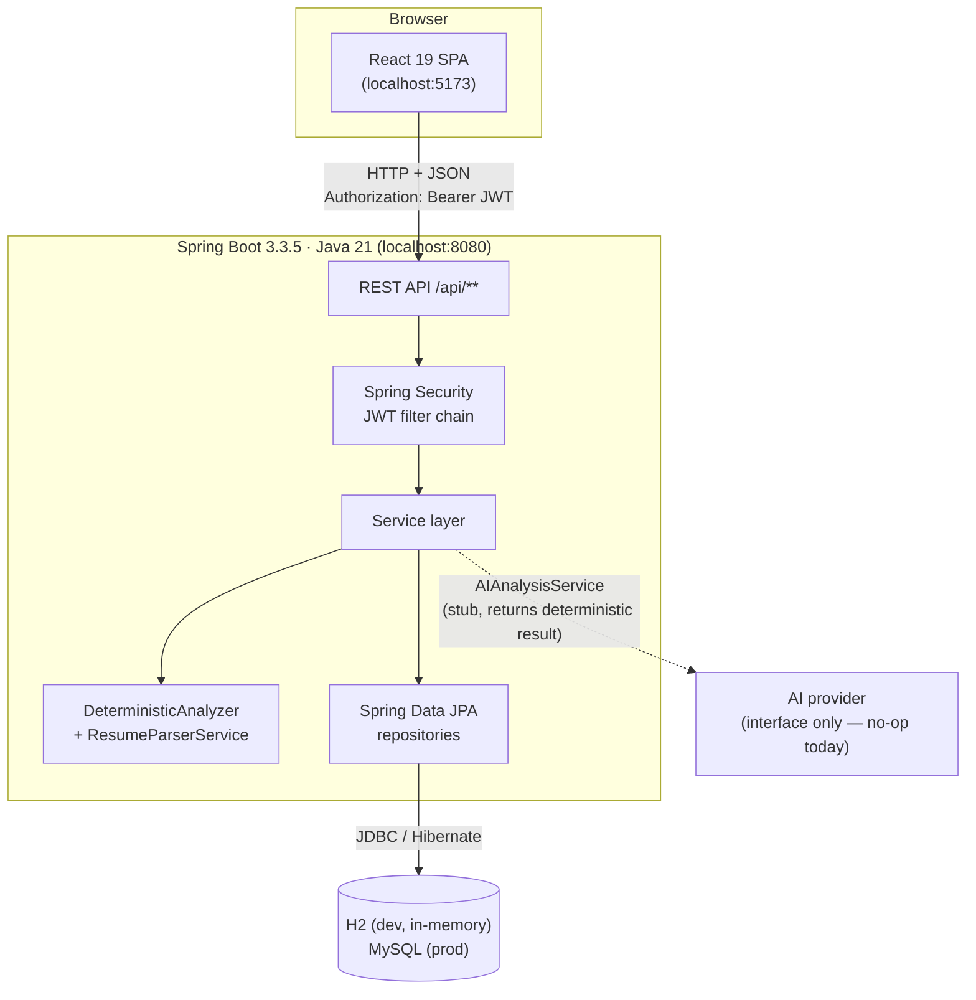

**Verified stack.**

| Layer | Technology | Evidence |
| --- | --- | --- |
| Backend language | Java 21 | `backend/pom.xml` `<java.version>21</java.version>` |
| Backend framework | Spring Boot 3.3.5 (web, data-jpa, security, validation) | `backend/pom.xml` |
| Build tool | Maven | `backend/pom.xml`, `Makefile` |
| Security | Spring Security 6 + JJWT 0.12.6 + BCrypt | `security/`, `config/SecurityConfig.java` |
| Persistence | Spring Data JPA / Hibernate | `repository/`, `entity/` |
| Databases | H2 (dev, in-memory, MySQL mode), MySQL (prod) | `application-dev.yml`, `application-prod.yml` |
| Schema migration | Flyway (`V1__initial_schema.sql`, `V2__baseline_constraints.sql`, `V3__widen_resume_file_type.sql`) | `resources/db/migration/` |
| PDF parsing | Apache PDFBox 3.0.3 | `parser/PdfResumeParser.java` |
| DOCX parsing | Apache POI 5.3.0 (`poi-ooxml`) | `parser/DocxResumeParser.java` |
| Boilerplate | Lombok | `backend/pom.xml` |
| Frontend | React 19, TypeScript 5.9, Vite 7, Tailwind CSS v4, React Router 7 | `frontend/package.json` |
| Frontend tests | Vitest | `frontend/package.json`, `frontend/vitest.config.ts` |

---

## 2. Backend architecture (current)

The backend is a layered Spring Boot application rooted at the package `com.resumeanalyzer`.

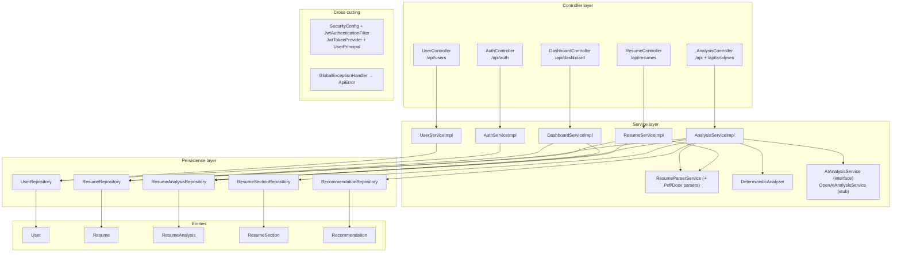

### 2.1 Packages and responsibility

| Package | Contents | Responsibility |
| --- | --- | --- |
| `controller/` | `AuthController`, `ResumeController`, `AnalysisController`, `DashboardController`, `UserController` | Thin HTTP layer; resolves the caller via `@AuthenticationPrincipal UserPrincipal` and delegates |
| `service/` + `service/impl/` | Auth, Resume, Analysis, Dashboard, User | Transactions, ownership checks, orchestration |
| `service/ai/` | `AIAnalysisService` (interface), `OpenAIAnalysisService` (stub) | Optional AI enhancement hook |
| `parser/` | `ResumeParserService`, `PdfResumeParser`, `DocxResumeParser`, `ParsedResume` | Text extraction + heuristic field/section parsing |
| `analyser/` | `DeterministicAnalyzer` | The 7-dimension scoring engine |
| `entity/` | `User`, `Resume`, `ResumeAnalysis`, `ResumeSection`, `Recommendation` | JPA domain model |
| `repository/` | 5 Spring Data repositories | Data access + custom `@Query` aggregations |
| `dto/` | `auth/`, `resume/`, `analysis/`, `dashboard/`, `user/` | Request/response payloads |
| `security/` | `JwtAuthenticationFilter`, `JwtTokenProvider`, `UserPrincipal`, `CustomUserDetailsService` | JWT issuance/validation and the security principal |
| `config/` | `SecurityConfig` | Filter chain, password encoder, CORS |
| `exception/` | `GlobalExceptionHandler` + typed exceptions | Map exceptions to `ApiError` |
| `common/` | `ApiError` | Shared error record |

> **Note on naming.** The package containing the scoring engine is spelled `analyser` (British) while
> the artifact/project name uses `analyzer`. Both spellings appear in the tree; this document matches
> the actual paths.

### 2.2 The scoring engine (`analyser/DeterministicAnalyzer.java`)

Seven dimensions, hard-coded weights summing to 1.00:

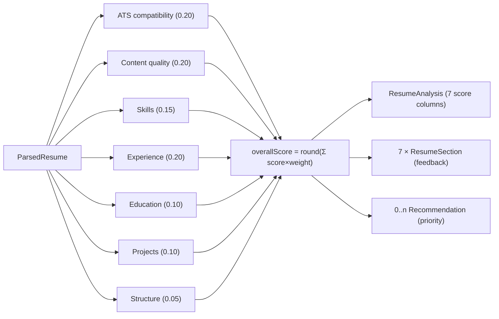

Signals per dimension:

| Dimension | Weight | Signal |
| --- | --- | --- |
| ATS compatibility | 0.20 | email, phone, location, standard headings |
| Content quality | 0.20 | word count, action verbs, metrics |
| Skills | 0.15 | number of recognised skills |
| Experience | 0.20 | experience section + verbs + metrics |
| Education | 0.10 | education section + whole-token degree keywords |
| Projects | 0.10 | projects section + links |
| Structure | 0.05 | ≥4 sections, email+phone present |

**Extraction rules that keep the score honest** (corrected 2026-10-28, with regression tests):

- **Sections** are detected from short heading-like lines (or the label before a colon), not from any
  occurrence of a keyword in body text. "I worked on some projects" no longer counts as a Projects
  section.
- **Location** is a case-sensitive `City, Country` / `City, ST` line in the first 12 non-empty lines;
  technology lists such as "Java, Spring Boot" are excluded.
- **Phone** must contain 9–15 digits and a separator or country code, so employee ids and year ranges
  are not treated as contact details.
- **Degree** keywords are matched as whole tokens (`BSc`, `B.S.`, `MS`, `Master`, …); the old
  substring check matched "we**bs**ite".
- **Skills** use symbol-safe boundaries, so `C++` and `C#` are detected.
- **Metrics** include percentages, currency, thousands separators (`4,000`) and `N+` counts (`15+`).

### 2.3 The parser (`parser/ResumeParserService.java`)

- `extractRawText(MultipartFile)` dispatches on the filename extension to `PdfResumeParser`
  (PDFBox) or `DocxResumeParser` (POI). **Only `.pdf` and `.docx` are accepted**; anything else
  throws `UnsupportedFileTypeException`.
- `parseText(String)` performs regex-based extraction of email/phone/location, **heading-based**
  section detection (`SUMMARY`, `EXPERIENCE`, `EDUCATION`, `SKILLS`, `PROJECTS`, `CERTIFICATIONS`,
  `LANGUAGES`), a fixed ~45-entry skill list, a fixed action-verb list, quantifiable-metric counting
  and word counting, producing a flat `ParsedResume`. Text is lower-cased with `Locale.ROOT` so the
  result is independent of the host locale.

### 2.4 AI integration today

`AIAnalysisService.enhanceAnalysis(...)` is called by `AnalysisServiceImpl` between the deterministic
analysis and persistence. `OpenAIAnalysisService` **logs and returns the deterministic result
unchanged** — there is no HTTP call, no embeddings and no provider client. The `ai.*` configuration
keys exist in `application.yml` but are only read to log a message. **No AI processing is implemented.**

---

## 3. Frontend architecture (current)

React 19 with TypeScript, Vite and Tailwind CSS v4. The UI is the Career-Compass frontend, ported
into `frontend/` and pointed at the existing Spring Boot API. State is request/response: a small
`useResource` hook fetches, pages re-fetch after mutations, and the JWT lives in `localStorage`.

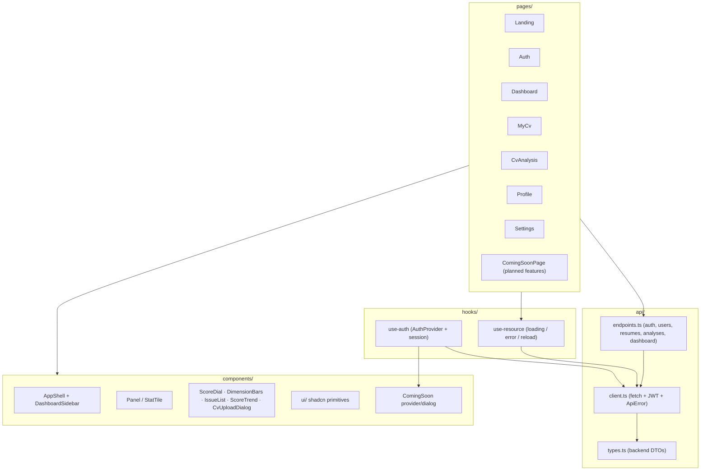

### 3.1 Routes (from `src/main.tsx`)

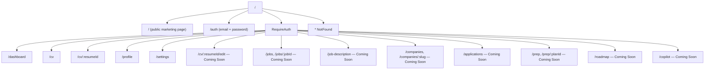

### 3.2 Frontend modules → backend endpoints

| Module | Methods | Endpoint(s) |
| --- | --- | --- |
| `api.auth` | `login(email, password)`, `register(username, email, password)` | `POST /api/auth/login`, `POST /api/auth/register` |
| `api.users` | `me()`, `update(username)` | `GET/PUT /api/users/me` |
| `api.resumes` | `list()`, `get(id)`, `upload(file)`, `remove(id)` | `/api/resumes*` |
| `api.analyses` | `history()`, `get(id)`, `forResume(id)`, `analyze(id)`, `remove(id)` | `/api/analyses*`, `/api/resumes/{id}/analyze` |
| `api.dashboard` | `stats()` | `GET /api/dashboard/stats` |
| `use-auth` | session restore, sign in/up/out | `/api/users/me` + JWT |
| `ThemeToggle` / Settings | `localStorage` theme via next-themes | n/a (client-only) |

The API base URL is `/api` by default: Vite proxies it to `http://localhost:8080` in development
(`vite.config.ts`), and `VITE_API_BASE_URL` overrides it with an absolute URL when the SPA is served
from a different origin.

---

## 4. Frontend ↔ backend communication

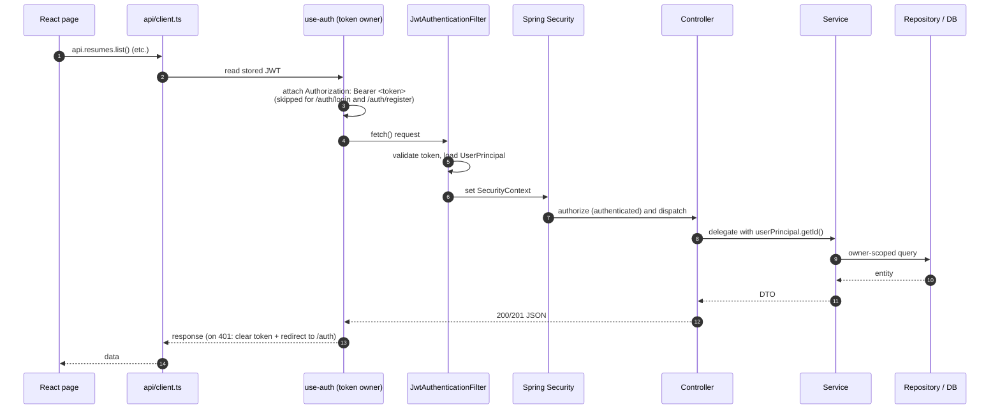

The interceptor (`core/interceptors/jwt.interceptor.ts`) attaches the bearer token and, on any
`401`, shows an error toast and logs the user out.

---

## 5. Authentication and authorization

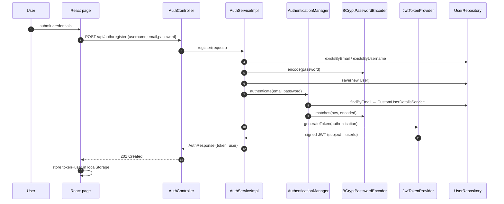


**Authorization model (current).**

- Authentication is **stateless** (`SessionCreationPolicy.STATELESS`), CSRF disabled (the API is
  bearer-token based).
- Permit-all paths: `/api/auth/**`, `/error`, `/v3/api-docs/**`, `/swagger-ui/**`,
  `/swagger-ui.html`. Everything else requires authentication.
- There is **no role system in use**: every user is granted the single authority `ROLE_USER`
  (`UserPrincipal.create`). `@EnableMethodSecurity` is enabled but no method-level rules are applied.
- **Authorization is enforced in the service layer** via owner-scoped repository queries
  (`findByIdAndUserId`, `findByIdAndResumeUserId`, `findByResumeUserIdOrderByAnalyzedAtDescIdDesc`),
  not by URL-pattern rules per resource.

> **Known risks (see §12):** `SecurityConfig` sets `allowedOriginPatterns("*")` together with
> `allowCredentials(true)`, and `application.yml` ships a hard-coded default JWT secret. The
> migration plan schedules both for hardening in Phase 14.

---

## 6. Database and storage

- **Technology:** a single relational database accessed through JPA/Hibernate.
  - **dev** (`application-dev.yml`): in-memory **H2** in MySQL compatibility mode
    (`jdbc:h2:mem:resume_db;DB_CLOSE_DELAY=-1;MODE=MySQL`), `ddl-auto: update`, H2 console enabled.
  - **prod** (`application-prod.yml`): **MySQL** (`jdbc:mysql://mysql:3306/resume_analyzer_db…`),
    `ddl-auto: validate`, Flyway enabled with `baseline-on-migrate: true`.
- **Schema migrations:** Flyway scripts in `backend/src/main/resources/db/migration/`. `V1` creates
  the five tables; `V2` adds baseline indexes; `V3` widens `resumes.file_type` to `VARCHAR(150)` so
  DOCX MIME types fit. In the dev profile Flyway is not explicitly enabled in the YAML, so H2 schema
  is primarily driven by `ddl-auto: update`; the Compose/prod backend runs Flyway on startup.
- **File storage:** there is **no external object store.** Uploaded files are not persisted; only the
  **extracted text** is stored in `resumes.extracted_text` (`LONGTEXT`). The original document is read
  in-memory during upload and discarded.

Full details, columns and the ERD are in [`DATABASE.md`](DATABASE.md).

---

## 7. External services and integrations

| Integration | Status |
| --- | --- |
| AI / LLM provider | **Interface only** — `AIAnalysisService` + `OpenAIAnalysisService` stub; no external calls. `ai.*` config keys exist but unused. |
| PDF/DOCX parsing libraries | In-process (PDFBox, POI) — not remote services. |
| OpenAPI/Swagger UI | **Not present.** `SecurityConfig` permits `/swagger-ui/**` and `/v3/api-docs/**`, but no dependency provides them (no springdoc). |
| Email, payments, object storage, analytics | None. |

---

## 8. Error handling, validation, logging and security

### 8.1 Error contract

All failures return the shared `ApiError` record
(`common/ApiError.java`):

```json
{
  "timestamp": "2026-10-14T03:36:25.123",
  "status": 404,
  "error": "Not Found",
  "code": "RESOURCE_NOT_FOUND",
  "message": "Resume not found or access denied",
  "path": "/api/resumes/42"
}
```

`GlobalExceptionHandler` maps:

| Exception | HTTP status | `code` |
| --- | --- | --- |
| `ResourceNotFoundException` | 404 | `RESOURCE_NOT_FOUND` |
| `BadRequestException` | 400 | `BAD_REQUEST` |
| `DuplicateResourceException` | 409 | `DUPLICATE_RESOURCE` |
| `UnsupportedFileTypeException` | 400 | `UNSUPPORTED_FILE_TYPE` |
| `UnauthorizedException` | 401 | `UNAUTHORIZED` |
| `BadCredentialsException` | 401 | `INVALID_CREDENTIALS` |
| `MaxUploadSizeExceededException` | 400 | `FILE_TOO_LARGE` |
| `MethodArgumentNotValidException` | 400 | `VALIDATION_ERROR` |
| any other `Exception` | 500 | `INTERNAL_ERROR` |

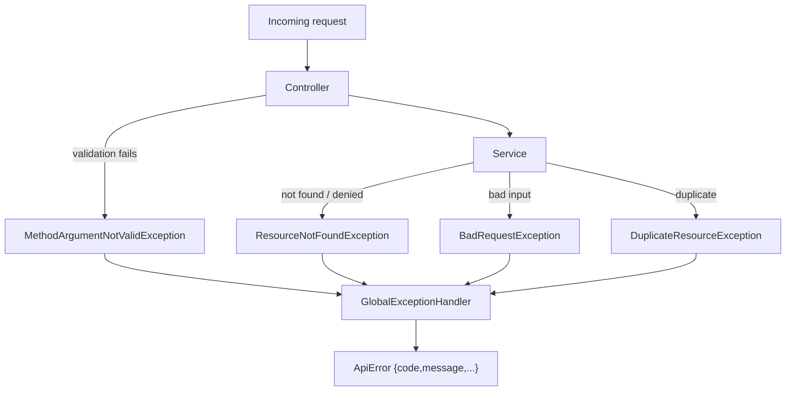

### 8.2 Validation
Jakarta Bean Validation annotations on request DTOs (`RegisterRequest`, `LoginRequest`,
`UpdateProfileRequest`) with `@Valid` on controller parameters. File type/size validation is implicit
via the extension check in `ResumeParserService` and the multipart limit (10 MB) in `application.yml`.

### 8.3 Logging
Spring Boot default logging via SLF4J; `@Slf4j` is used in `OpenAIAnalysisService`. `show-sql` is
`false` in both profiles. No structured/audit logging or request tracing is configured.

### 8.4 Security summary
- Passwords hashed with BCrypt.
- JWT signed with HMAC-SHA256; the secret is decoded from Base64 (with a UTF-8 fallback and 32-byte
  padding).
- CORS: all origins, all common methods, `allowCredentials(true)` — see §12.
- No rate limiting, no refresh tokens, no account lockout, no audit log.

---

## 9. Deployment architecture (current)

Local development is described above; the repository now ships a **three-service Docker Compose
stack**. There is still no deploy workflow (release to a hosting provider, TLS termination at the
edge, secrets manager and monitoring are open items — see
[`COMPLETION_CHECKLIST.md`](COMPLETION_CHECKLIST.md)).

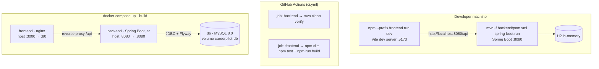

**Image and runtime details.**

| Service | Image / build | Runtime | Healthcheck |
| --- | --- | --- | --- |
| `frontend` | `node:22-alpine` build → `nginx:1.27-alpine` | static SPA + `/api` reverse proxy | `wget --spider /` |
| `backend` | `maven:3.9-eclipse-temurin-21` build → `eclipse-temurin:21-jre-alpine` | `java -jar app.jar`, non-root user, `SPRING_PROFILES_ACTIVE=prod` | HTTP 401 from a protected endpoint |
| `db` | `mysql:8.0` | named volume `careerpilot-db` | `mysqladmin ping` |

`depends_on` uses `condition: service_healthy`, so the backend waits for MySQL and nginx waits for
the backend. The frontend build takes `VITE_API_BASE_URL=/api` (same origin), and nginx raises
`client_max_body_size` to 10 MB to match the backend's upload limit. nginx also re-resolves the
`backend` service through Docker's embedded DNS, so recreating the backend container does not leave
nginx proxying a stale IP.

### 9.1 Container topology

The Compose project is named `careerpilot`. Only two ports are published (frontend 3000, backend
8080 by default); MySQL is reachable only on the internal network. Every credential and port can be
overridden from the environment (`MYSQL_DATABASE`, `MYSQL_USER`, `MYSQL_PASSWORD`,
`MYSQL_ROOT_PASSWORD`, `JWT_SECRET`, `BACKEND_PORT`, `FRONTEND_PORT`).

---

## 10. Testing architecture (current)

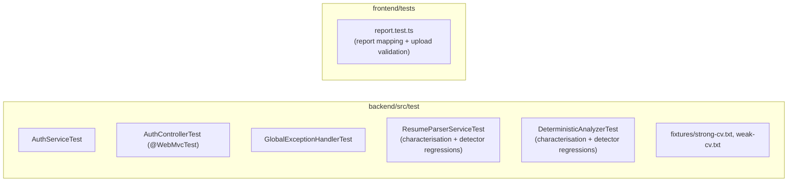

- Backend: **33 tests**, all green (`mvn -f backend/pom.xml clean verify`).
- Frontend: **11 tests** (`npm --prefix frontend test`).
- The parser and analyser suites are *characterisation* tests added in Phase 0 to pin the current
  behaviour before it is refactored; they were updated and extended in the 2026-10-28 correctness
  pass with regression tests for the contact, heading, degree, symbol-skill and metric detectors.

---

## 11. Proposed target architecture (from the migration plan)

> **Everything in this section is proposed, not implemented.** It is reproduced from
> [`CAREERPILOT_MIGRATION_PLAN.md`](../CAREERPILOT_MIGRATION_PLAN.md) §4.

The target is a **modular monolith**: one Spring Boot deployable, package-by-feature, each domain
module owning its entities, repositories, services, controllers and pure engines. Deterministic
engines are added first; AI-dependent layers last, always behind an interface with an offline fallback.

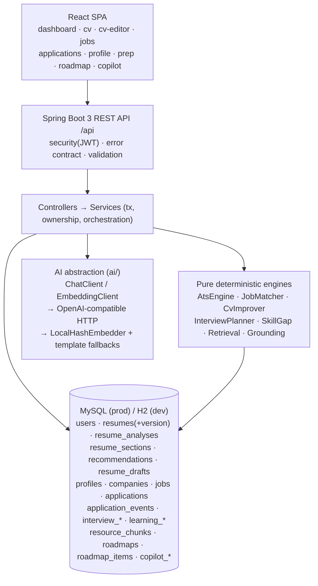

### 11.1 Proposed package layout (from the plan §4.1)

```
com.resumeanalyzer
├── config/            SecurityConfig, CorsConfig, AsyncConfig, OpenApiConfig
├── security/          JWT filter, provider, UserPrincipal, CustomUserDetailsService
├── common/            ApiError, GlobalExceptionHandler, paging, clock
├── analysis/          engine (AtsEngine, dimensions, KeywordAnalyzer, GradeCalculator),
│                      TaxonomyService, CareerStageRules + controller/service/repository/dto
├── cv/                parser (…, TxtResumeParser), editor (CvImprover),
│                      template (AtsTemplateBuilder, PdfExporter) + controller/service/entity/dto
├── profile/           CandidateProfile + service/controller/dto
├── catalog/           Company, Job + seeded importer + search
├── matching/          JobMatcher (pure) + MatchController
├── application/       JobApplication, ApplicationEvent + state machine
├── interview/         InterviewPlan, PrepTask, InterviewQuestion, QuestionPractice + InterviewPlanner
├── roadmap/           SkillGapAnalyzer, LearningResource, ResourceChunk, Roadmap, RoadmapItem
│   └── rag/           Chunker, EmbeddingClient, Retrieval, RoadmapPrompt, Grounding
├── copilot/           CopilotDocument, CopilotChunk, Conversation, Message + Retrieval + Grounding
├── ai/                ChatClient, EmbeddingClient + OpenAiCompatibleClient + LocalHashEmbedder
└── dashboard/         readiness aggregation (extends DashboardService)
```

### 11.2 Proposed layering rules (from the plan §4.2)

- **Engines are pure** — no Spring, no JPA, no network — so they are unit-testable and deterministic.
- **Services orchestrate** transactions, ownership and persistence; they call engines and (only when
  configured) AI clients.
- **Controllers are thin and authenticated**, resolving the caller from the JWT `UserPrincipal`.
- **AI is behind interfaces** with deterministic fallbacks; nothing else may depend on a concrete
  provider.

### 11.3 Current vs target — key differences

| Concern | Current | Proposed target |
| --- | --- | --- |
| Scoring | 7 dimensions, coarse feedback | 10 explainable dimensions, severity/explanation/recommendation, grades, keyword modes |
| Parsing | regex, flat model, PDF/DOCX | structured model, ~150-skill taxonomy, TXT |
| CV model | one row per upload | versioned (`version`, `isCurrent`, target role/job ad, parsed snapshot) |
| Recommendations | rows tied to one analysis | persistent, status-tracked, stable key across re-scans |
| Catalog/matching/applications/interview/roadmap/copilot | none | new domain modules |
| AI | no-op stub | provider abstraction + embeddings + deterministic fallbacks |
| Vector storage | none | embeddings stored in MySQL (`LONGTEXT`) with a `model` column, ranked in-process |
| Async generation | none | entity status machine (`analyzing → generating → ready/failed`) + `@Async` executor + stale-run guard |
| Security | CORS `*` with credentials; default JWT secret | environment-scoped CORS; required `JWT_SECRET` outside dev |

---

## 12. Known limitations and architectural risks (current)

| # | Observation | Impact | Notes |
| --- | --- | --- | --- |
| 1 | `allowedOriginPatterns("*")` + `allowCredentials(true)` in `SecurityConfig` | Permissive CORS | Scheduled for hardening (plan Phase 14) |
| 2 | Hard-coded default JWT secret in `application.yml` | Token forgery if unchanged in prod | Scheduled for hardening |
| 3 | `OpenAIAnalysisService` is a no-op stub | No AI capabilities despite config keys | Intentional; AI is P2 |
| 4 | No object storage — original file discarded | No CV download/re-download | Plan keeps DB-stored text; storage optional (P2) |
| 5 | Flyway only explicitly enabled in prod profile; dev relies on `ddl-auto: update` | Dev/prod schema drift risk | `V2`/`V3` are written to be valid on both H2 (MySQL mode) and MySQL |
| 6 | Frontend test coverage is thin | Regressions in UI code can slip | Extend the Vitest suites with component tests |
| 7 | No pagination on list endpoints | Unbounded response size at scale | Acceptable at current scale |
| 8 | Stray `backend/src/java/com/resumeanalyzer/ResumeAnalyzerApplication.java` (identical duplicate outside the Maven source root) | Confusing; ignored by the build | Housekeeping candidate (see `commit.txt`) |
| 9 | `analyser` vs `analyzer` package spelling | Minor inconsistency | Preserved to avoid churn |
| 10 | Compose stack exists, but no production deploy pipeline (TLS, managed DB, backups, monitoring) | Self-hosted only; operational hardening outstanding | Tracked as checkboxes in [`COMPLETION_CHECKLIST.md`](COMPLETION_CHECKLIST.md) |
