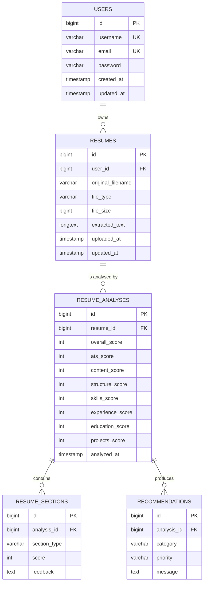
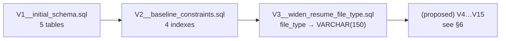
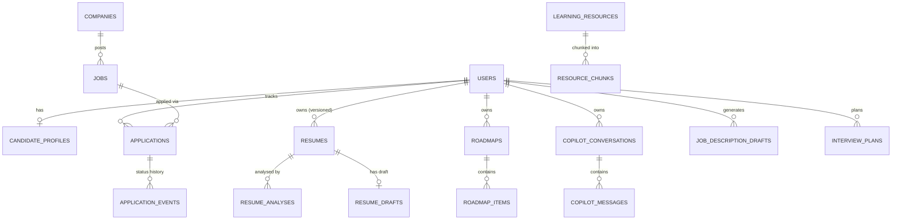

# CareerPilot — Database Design

> **Evidence base.** This document is derived from the Flyway migrations
> (`backend/src/main/resources/db/migration/`), the JPA entities (`entity/`) and the repository
> queries. Nothing here is invented: if a table or column is not in those files, it is not claimed to
> exist. Proposed tables are clearly separated in §6.

---

## 1. Database technology and configuration

CareerPilot uses a **single relational database** accessed through **Spring Data JPA / Hibernate**.

| Profile | Database | JDBC URL default | `ddl-auto` | Flyway | Evidence |
| --- | --- | --- | --- | --- | --- |
| dev (default) | **H2**, in-memory, MySQL compatibility mode | `jdbc:h2:mem:resume_db;DB_CLOSE_DELAY=-1;MODE=MySQL` | `update` | not enabled in `application-dev.yml` | `application-dev.yml` |
| prod | **MySQL** | `jdbc:mysql://mysql:3306/resume_analyzer_db?useSSL=false&allowPublicKeyRetrieval=true&serverTimezone=UTC` (overridden to `db:3306` by Compose) | `validate` | enabled, `baseline-on-migrate: true`, `classpath:db/migration` | `application-prod.yml` |

Connection settings are environment-overridable via `DB_URL`, `DB_USERNAME`, `DB_PASSWORD`,
`DB_DRIVER`, `DB_DIALECT`.

`docker-compose.yml` starts the production-like topology: the **`db`** service runs MySQL 8.0 with a
named volume, and the **`backend`** service starts with `SPRING_PROFILES_ACTIVE=prod` and an explicit
`DB_URL` pointing at `db:3306`. Flyway therefore creates and migrates the schema on first start.

- **dev** relies on Hibernate `ddl-auto: update` to create the schema; the H2 console is available at
  `/h2-console`.
- **prod** relies on **Flyway** to create/migrate the schema (`V1`, `V2`, `V3`) and on
  `ddl-auto: validate` to assert the entities match it.
- Because MySQL does not support `CREATE INDEX IF NOT EXISTS`, `V2` uses plain `CREATE INDEX` and
  relies on Flyway's version tracking for idempotency. The statements are written to be valid on both
  MySQL and H2 in MySQL mode.

> **Secrets:** the production `DB_PASSWORD` value in `application-prod.yml` is a placeholder default,
> not a real credential. No secrets are committed. Override it via the environment.

---

## 2. Current tables

Each table below lists the columns from the Flyway DDL (`V1__initial_schema.sql`), reconciled with the
JPA entity mappings.

### 2.1 `users`

| Column | Type | Constraints | Entity field |
| --- | --- | --- | --- |
| `id` | BIGINT | PK, AUTO_INCREMENT (IDENTITY) | `User.id` |
| `username` | VARCHAR(50) | NOT NULL, UNIQUE | `User.username` |
| `email` | VARCHAR(100) | NOT NULL, UNIQUE | `User.email` |
| `password` | VARCHAR(255) | NOT NULL (BCrypt hash) | `User.password` |
| `created_at` | TIMESTAMP | DEFAULT CURRENT_TIMESTAMP, not updatable | `User.createdAt` |
| `updated_at` | TIMESTAMP | DEFAULT + ON UPDATE CURRENT_TIMESTAMP (MySQL) | `User.updatedAt` |

### 2.2 `resumes`

| Column | Type | Constraints | Entity field |
| --- | --- | --- | --- |
| `id` | BIGINT | PK, AUTO_INCREMENT | `Resume.id` |
| `user_id` | BIGINT | NOT NULL, FK → `users(id)` ON DELETE CASCADE | `Resume.user` |
| `original_filename` | VARCHAR(255) | NOT NULL | `Resume.originalFilename` |
| `file_type` | VARCHAR(150) | NOT NULL (widened by `V3`) | `Resume.fileType` |
| `file_size` | BIGINT | NOT NULL | `Resume.fileSize` |
| `extracted_text` | LONGTEXT | nullable | `Resume.extractedText` |
| `uploaded_at` | TIMESTAMP | DEFAULT CURRENT_TIMESTAMP, not updatable | `Resume.uploadedAt` |
| `updated_at` | TIMESTAMP | DEFAULT + ON UPDATE CURRENT_TIMESTAMP (MySQL) | `Resume.updatedAt` |

> **No file/version columns exist.** A résumé is one row per upload; there is no `version`,
> `isCurrent`, `targetRole`, `jobDescription` or stored parse snapshot today.

### 2.3 `resume_analyses`

| Column | Type | Constraints | Entity field |
| --- | --- | --- | --- |
| `id` | BIGINT | PK, AUTO_INCREMENT | `ResumeAnalysis.id` |
| `resume_id` | BIGINT | NOT NULL, FK → `resumes(id)` ON DELETE CASCADE | `ResumeAnalysis.resume` |
| `overall_score` | INT | NOT NULL | `overallScore` |
| `ats_score` | INT | NOT NULL | `atsScore` |
| `content_score` | INT | NOT NULL | `contentScore` |
| `structure_score` | INT | NOT NULL | `structureScore` |
| `skills_score` | INT | NOT NULL | `skillsScore` |
| `experience_score` | INT | NOT NULL | `experienceScore` |
| `education_score` | INT | NOT NULL | `educationScore` |
| `projects_score` | INT | NOT NULL | `projectsScore` |
| `analyzed_at` | TIMESTAMP | DEFAULT CURRENT_TIMESTAMP, not updatable | `analyzedAt` |

### 2.4 `resume_sections`

| Column | Type | Constraints | Entity field |
| --- | --- | --- | --- |
| `id` | BIGINT | PK, AUTO_INCREMENT | `ResumeSection.id` |
| `analysis_id` | BIGINT | NOT NULL, FK → `resume_analyses(id)` ON DELETE CASCADE | `ResumeSection.analysis` |
| `section_type` | VARCHAR(50) | NOT NULL | `sectionType` |
| `score` | INT | NOT NULL | `score` |
| `feedback` | TEXT | nullable | `feedback` |

### 2.5 `recommendations`

| Column | Type | Constraints | Entity field |
| --- | --- | --- | --- |
| `id` | BIGINT | PK, AUTO_INCREMENT | `Recommendation.id` |
| `analysis_id` | BIGINT | NOT NULL, FK → `resume_analyses(id)` ON DELETE CASCADE | `Recommendation.analysis` |
| `category` | VARCHAR(50) | NOT NULL | `category` |
| `priority` | VARCHAR(20) | NOT NULL (values used: Critical/Important/Suggested) | `priority` |
| `message` | TEXT | NOT NULL | `message` |

---

## 3. Primary keys, foreign keys and cardinalities

| Relationship | Cardinality | Delete behaviour |
| --- | --- | --- |
| `users` → `resumes` | 1 : N | CASCADE (deleting a user deletes their résumés) |
| `resumes` → `resume_analyses` | 1 : N | CASCADE |
| `resume_analyses` → `resume_sections` | 1 : N | CASCADE |
| `resume_analyses` → `recommendations` | 1 : N | CASCADE |

JPA mirrors this with `@OneToMany(mappedBy = …, cascade = ALL, orphanRemoval = true)` on `Resume`,
`ResumeAnalysis` (×2), and `@ManyToOne` on the child entities.

---

## 4. Indexes and uniqueness constraints

| Kind | Name | Columns | Source |
| --- | --- | --- | --- |
| Unique | (inline) | `users.username` | `V1` |
| Unique | (inline) | `users.email` | `V1` |
| Index | (implicit FK index, MySQL) | `resumes.user_id` | FK |
| Index | (implicit FK index, MySQL) | `resume_analyses.resume_id` | FK |
| Index | (implicit FK index, MySQL) | `resume_sections.analysis_id` | FK |
| Index | (implicit FK index, MySQL) | `recommendations.analysis_id` | FK |
| Index | `idx_resume_analyses_resume_analyzed` | `resume_analyses(resume_id, analyzed_at)` | `V2` |
| Index | `idx_resumes_user_id` | `resumes(user_id)` | `V2` |
| Index | `idx_resume_sections_analysis` | `resume_sections(analysis_id)` | `V2` |
| Index | `idx_recommendations_analysis` | `recommendations(analysis_id)` | `V2` |

The `V2` indexes mirror the composite/foreign-key access patterns of the repository queries
(`findByUserIdOrderByUploadedAtDescIdDesc`, `findByResumeIdOrderByAnalyzedAtDescIdDesc`,
`findByAnalysisId`). The list queries add `id DESC` as a tie-breaker because `uploaded_at` and
`analyzed_at` have second precision, so two rows created in the same second still return newest first.

---

## 5. Migration strategy

- **Tool:** Flyway, versioned SQL scripts in `backend/src/main/resources/db/migration/`.
- **Naming:** `V<n>__<description>.sql` (`V1__initial_schema.sql`, `V2__baseline_constraints.sql`,
  `V3__widen_resume_file_type.sql`).
- **Where it runs:** enabled in the **prod** profile with `baseline-on-migrate: true`; the dev profile
  uses Hibernate `ddl-auto: update` instead. The Compose backend runs the prod profile, so every
  container start applies pending migrations.
- **Prod safety:** `ddl-auto: validate` means the entities must match the migrated schema exactly or
  the application fails to start — so every schema change must ship a migration.

> **Migration numbering.** `V3` is already taken by the `file_type` widening, so the roadmap
> migrations listed below (numbered V3…V14 in the original plan) must be allocated from **V4**
> onward. The names are indicative; only `V1`–`V3` exist today.

---

## 6. Proposed schema changes (from the migration plan — **not implemented**)

> These tables/columns are **planned**, not present. They are listed so the roadmap is explicit.
> Source: [`CAREERPILOT_MIGRATION_PLAN.md`](../CAREERPILOT_MIGRATION_PLAN.md) §6.

| Migration | Change | Purpose |
| --- | --- | --- |
| `V4__analysis_engine_fields.sql` | Add `grade`, `band`, `engine_version`, keyword columns to `resume_analyses`; add `severity`, `explanation`, `recommendation_text`, `dimension` to `recommendations` | 10-dimension explainable engine |
| `V4__resume_versioning.sql` | Add `version`, `is_current`, `label`, `career_stage`, `target_role`, `job_description`, `parsed`, `score`, `grade`, `analyzed_at` to `resumes` (+ backfill) | CV versioning & re-scan |
| `V5__persistent_recommendations.sql` | Add `key`, `dimension`, `title`, `problem`, `why`, `action`, `status`, timestamps to `recommendations` | Status-tracked findings |
| `V6__candidate_profiles.sql` | New `candidate_profiles` table | Candidate profile |
| `V7__catalog.sql` | New `companies`, `jobs` tables + indexes | Job catalog |
| `V8__applications.sql` | New `applications`, `application_events` tables | Application tracking |
| `V9__resume_drafts.sql` | New `resume_drafts` table | CV editor |
| `V10__job_description_drafts.sql` | New `job_description_drafts` table | JD generator |
| `V11__interview_prep.sql` | New `interview_plans`, `prep_tasks`, `interview_questions`, `question_practices` | Interview prep |
| `V12__learning_resources_and_chunks.sql` | New `learning_resources`, `resource_chunks` (embedding `LONGTEXT` + `model`) | RAG foundation |
| `V13__roadmaps.sql` | New `roadmaps`, `roadmap_items` | Learning roadmap |
| `V14__career_copilot.sql` | New `copilot_documents`, `copilot_chunks`, `copilot_conversations`, `copilot_messages` | AI Career Copilot |

**Proposed ERD (target — illustrative, not current):**

**Vector storage decision (proposed).** Embeddings are stored in MySQL as `LONGTEXT`/`BLOB` (a JSON
float array) with a `model` column, and ranked **in-process** over a bounded, indexed candidate set —
mirroring the reference project. A dedicated vector store (pgvector/Qdrant) is an optional
scaling path only, not on the critical path.

---

## 7. Data lifecycle and privacy notes (current)

- Résumé **extracted text is personal data**; it is stored so a résumé can be re-analysed. It is
  removed when the résumé (or its owning user) is deleted, via `ON DELETE CASCADE`.
- The original uploaded file is **not stored** — only the extracted text.
- All reads/writes are **owner-scoped** by `user_id` through repository queries
  (`findByIdAndUserId`, `findByIdAndResumeUserId`), so one user cannot read another's data.
