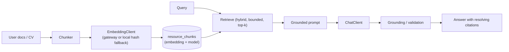

# CareerPilot — Feature Roadmap

> **How to read this document.** Each feature states its **current status** (verified against this
> repository), the work required on each layer, dependencies, the implementation order and acceptance
> criteria. Planned work is taken from [`CAREERPILOT_MIGRATION_PLAN.md`](../CAREERPILOT_MIGRATION_PLAN.md);
> it is **not** implemented unless marked ✅.
>
> **Status legend.** ✅ Implemented · 🟡 Partial · ⏳ Planned · 🅿️ Priority (P0 essential, P1
> important, P2 advanced).

---

## 0. Phase map

```mermaid
graph LR
    P0["Phase 0 · baseline & tests 🅿️P0 ✅"] --> P1["Phase 1 · taxonomy + parser 🅿️P0"]
    P1 --> P2["Phase 2 · 10-dim engine 🅿️P0"]
    P2 --> P3["Phase 3 · CV versioning 🅿️P0"]
    P3 --> P4["Phase 4 · persistent recs 🅿️P1"]
    P4 --> P5["Phase 5 · profile + readiness 🅿️P1"]
    P5 --> P6["Phase 6 · catalog + matching 🅿️P1"]
    P6 --> P7["Phase 7 · applications 🅿️P1"]
    P7 --> P8["Phase 8 · editor + PDF 🅿️P1"]
    P8 --> P9["Phase 9 · JD generator 🅿️P2"]
    P9 --> P10["Phase 10 · interview prep 🅿️P2"]
    P10 --> P11["Phase 11 · RAG foundation 🅿️P2"]
    P11 --> P12["Phase 12 · roadmap 🅿️P2"]
    P12 --> P13["Phase 13 · copilot 🅿️P2"]
    P13 --> P14["Phase 14 · verification & hardening"]
```

Phase 0 (baseline guardrails, characterisation tests, `ApiError`, CI) is **already merged** in the
repository (commit `86fbeeb`). Everything from Phase 1 onward is planned.

**Baseline correction (2026-10-28).** A correctness pass fixed defects in the existing detectors that
made the 7-dimension score wrong for common documents: technology lists were read as locations,
numeric ids as phone numbers, "website" as a "BS" degree, `C++`/`C#` were never detected, `15+`
metrics were never counted, and body-text mentions counted as sections. The characterisation tests
were updated to the corrected values and extended with regression tests. The dimension weights,
response contract and endpoint behaviour are unchanged.

---

## 1. Existing ATS checker — preserve and improve

**Status: 🟡 Partial (7-dimension engine implemented; explainability limited).**

**Description / benefit.** The current engine scores seven dimensions and produces section feedback
plus prioritised recommendations. The improvement is *explainability*: every deduction should say
**what** is wrong, **why** it matters and **how** to fix it, so the score is actionable.

| Aspect | Current | Target |
| --- | --- | --- |
| Dimensions | 7 (weights 20/20/15/20/10/10/5) | 10 (structure 16, keywords 14, skills 14, experience 10, contact 10, formatting 8, education 8, projects 8, readability 6, impact 6) |
| Findings | coarse section feedback + recommendation rows | per-finding severity (`critical`/`warning`/`info`) + explanation + recommendation |
| Grade | none | A ≥ 90, B ≥ 80, C ≥ 70, D ≥ 55, E below |
| Keywords | none | 3 modes: `job_description`, `target_role`, `general` |
| Career stage | none | required sections vary by student/intern/graduate/early-career |

**Frontend work:** render dimension bars, issue lists (severity + explanation + recommendation),
highlights, next steps and keyword panels; add a career-stage / target-role selector to the analyse
form.

**Backend work:** `analysis/engine/*` (one class per dimension + `AtsEngine`, `KeywordAnalyzer`,
`GradeCalculator`); `CareerStageRules`; keep `ResumeSection`/`Recommendation` populated for backward
compatibility.

**Database:** `V3__analysis_engine_fields.sql` (additive columns).

**API:** `POST /api/resumes/{id}/analyze` gains optional `careerStage`, `targetRole`, `jobDescription`
inputs; response gains additive fields.

**Dependencies:** Phase 1 (taxonomy/parser).

**Acceptance criteria:** weights sum to 100; `overallScore` equals the weighted average (asserted);
deterministic; a structured CV scores strictly higher than an unstructured one; missing email → a
`critical` contact issue; missing metrics → a `warning` impact issue; existing `GET /api/analyses/{id}`
still deserialises in the React client.

---

## 2. CV upload, parsing, and management

**Status: 🟡 Partial (upload/list/detail/delete ✅; structured parsing + TXT ⏳).**

**Description / benefit.** Richer parsing produces a structured model (contact, sections, entries,
skills with categories/aliases, stats) that powers matching, the editor and skill-gap analysis.

| Capability | Current | Target |
| --- | --- | --- |
| PDF/DOCX upload | ✅ server PDFBox/POI | unchanged |
| TXT upload | ❌ | ✅ `TxtResumeParser` |
| Contact/name/links | ⚠️ email/phone/location only | full contact model |
| Skill detection | ⚠️ ~45 flat list | ~150 skills, aliases + categories |
| Section detection | ⚠️ keyword contains | heading dictionary incl. certifications/languages/awards |
| Entries + stats | ❌ flat text only | grouped entries + `CvStats` (word/bullet counts, quantified bullets, …) |

**Frontend work:** show parsed structure (not just raw text); support `.txt` in the upload modal.

**Backend work:** port taxonomy (`SkillDictionary`, `RoleProfiles`, `HeadingDictionary`,
`Stopwords`), expand `ParsedResume`, add focused parsers, add `TxtResumeParser`.

**Database:** none for parsing itself (the parsed snapshot column arrives in Phase 3).

**API:** upload endpoint accepts `.txt`; detail endpoint may expose the structured parse
(additive).

**Dependencies:** Phase 0.

**Acceptance criteria:** the strong-CV fixture yields the expected email/phone/≥10 skills with
categories and section keys; parsing is deterministic; a CV with no Kubernetes/Master content yields
neither (no fabrication); `.txt`/`.pdf`/`.docx` all extract text.

---

## 3. ATS scoring and job-description matching

**Status: ⏳ Planned (keyword matching is Phase 2; job matching is Phase 6).**

**Description / benefit.** Let a candidate score their CV against a **target role** or a **pasted job
ad**, and later match against catalog jobs with an explainable breakdown.

**Frontend work:** target-role/job-ad input; matched/missing keyword panel; match page with
matched/missing/bonus skills, blockers and recommendations.

**Backend work:** `KeywordAnalyzer` (3 modes) and, later, `JobMatcher` (skills 45, seniority 18,
location 15, role 12, extras 10).

**Database:** catalog tables (`V7`) for job matching; keyword columns (`V3`).

**API:** extended analyse request (Phase 2); `GET /api/jobs/{id}/match` (Phase 6, proposed).

**Dependencies:** taxonomy (Phase 1) → keyword analysis (Phase 2) → profile + catalog (Phases 5–6).

**Acceptance criteria:** the canonical example (Java/Spring Boot/PostgreSQL matched, Kubernetes
missing) holds; missing required skills appear in `missingSkills` with a recommendation; match weights
sum to 100.

---

## 4. Professional summary generation

**Status: ⏳ Planned (part of the CV-improvement work).**

**Description / benefit.** Generate a professional summary from the parsed CV — deterministically,
and **without inventing** facts — with an optional AI variant behind the provider abstraction.

**Frontend work:** summary field in the CV editor; a "generate" action with a clear "may be a
deterministic template" label.

**Backend work:** template summary builder in `cv/editor` (Phase 8); optional chat-model path in
Phase 9.

**Database:** `resume_drafts` (`V9`).

**API:** `POST /api/cvs/{id}/generate` (proposed).

**Dependencies:** parsed model (Phase 1), engine (Phase 2), editor (Phase 8).

**Acceptance criteria:** generated text contains no fact absent from the draft; with no API key a
labelled deterministic result is returned.

---

## 5. AI and RAG functionality

**Status: ⏳ Planned (P2). Today the AI service is a **no-op stub** — no external calls exist.**

**Description / benefit.** Job-description generation, interview preparation, a grounded learning
roadmap and a grounded Career Copilot. Each uses retrieval over a curated corpus and **must degrade**
to a deterministic result when no key is configured.

**Frontend work:** JD generator, interview planner, roadmap and copilot chat UIs, each with
loading/retry/fallback states.

**Backend work:** `ai/` abstraction (`ChatClient`, `EmbeddingClient`, `LocalHashEmbedder`,
`Cosine`); `roadmap/rag` and `copilot/rag` building blocks; template fallbacks; async status machine.

**Database:** `V10`–`V14` (see [`DATABASE.md`](DATABASE.md) §6).

**API:** proposed JD/interview/roadmap/copilot endpoints (see [`API.md`](API.md) §8).

**Dependencies:** Phases 1, 5, 9, 11 (in order).

**Acceptance criteria:** every AI feature works end-to-end with no key (labelled deterministic
output); malformed model output never persists; grounded citations always resolve to retrieved
passages; no secrets or document text in logs.

---

## 6. User authentication and protected routes

**Status: ✅ Implemented (JWT); the reference's OTP/guest auth is deliberately **not** migrated.**

**Description / benefit.** Email/password registration and login; stateless JWT; protected React
routes.

**What exists:** `AuthController`, `AuthServiceImpl` (BCrypt, `AuthenticationManager`),
`JwtTokenProvider`, `JwtAuthenticationFilter`, `SecurityConfig`; frontend `AuthService`,
`jwtInterceptor`, `authGuard`, `guestGuard`.

**Planned hardening (Phase 14):** environment-scoped CORS (currently `*` with credentials) and a
required `JWT_SECRET` outside dev (currently a hard-coded default).

**Acceptance criteria:** existing `/api/auth/*` behaviour unchanged; no secret committed; protected
routes redirect unauthenticated users to `/login`.

---

## 7. Dashboard and analysis history

**Status: 🟡 Partial (basic stats + history ✅; career-readiness metric ⏳).**

**Description / benefit.** Extend the dashboard with a **career-readiness** metric (CV 40% + profile
30% + pipeline 30%) and a "next action".

**Frontend work:** readiness gauge, profile-completeness panel, next-action callout.

**Backend work:** `CompletenessCalculator`, `ReadinessCalculator`; extend `DashboardServiceImpl`.

**Database:** `candidate_profiles` (`V6`).

**API:** extend `GET /api/dashboard/stats` (additive).

**Dependencies:** Phases 2, 3, 5.

**Acceptance criteria:** completeness and readiness reproduce the documented formulas; dashboard
response stays backward compatible.

---

## 8. CV versioning and document management

**Status: ⏳ Planned.**

**Description / benefit.** Re-uploading or re-scanning should preserve history so candidates can
compare versions and track score trends.

**Frontend work:** version list, set-current, rename, re-scan dialog, score-trend chart.

**Backend work:** version-on-upload (`version = max+1`, flip `isCurrent`), `reanalyze`, `setCurrent`,
`rename`; `@Version` optimistic locking.

**Database:** `V4__resume_versioning.sql` (+ backfill).

**API:** `PUT /api/resumes/{id}/current`, `PATCH /api/resumes/{id}`, `POST /api/resumes/{id}/reanalyze`
(proposed).

**Dependencies:** Phases 1–2.

**Acceptance criteria:** two uploads yield version 1 then 2 with only the latest current; a re-scan
produces a new analysis and updates the denormalised score; deleting a version cascades its analyses;
existing endpoints remain additive.

---

## 9. Testing, security, deployment, and monitoring

**Status: 🟡 Partial.**

| Concern | Current | Planned |
| --- | --- | --- |
| Backend tests | 33 tests (5 classes) | engine/service/controller/integration suites per feature |
| Frontend tests | 11 Vitest tests | Component and integration suites for new modules |
| CI | ✅ GitHub Actions (`ci.yml`) | unchanged, plus more coverage |
| Security | BCrypt + JWT; CORS `*` + credentials; default JWT secret | scoped CORS; required `JWT_SECRET`; upload validation hardening |
| Deployment | ✅ Docker Compose (db + backend + frontend) | production pipeline, TLS, managed DB, backups, monitoring |
| Monitoring | ❌ none | not in scope for the plan |

**Description / benefit.** Verification keeps the deterministic engines trustworthy and the API
backward compatible; hardening closes the two known security gaps.

**Dependencies / order:** tests ship with each phase; hardening is Phase 14 (last).

**Acceptance criteria:** `mvn -f backend/pom.xml clean verify` and
`npm --prefix frontend test -- --watch=false` are green with no disabled tests or weakened
assertions; no cross-user data access; no secrets in logs.

---

## 10. Prioritised summary

| Feature | Status | Priority | Phase |
| --- | --- | --- | --- |
| Baseline guardrails & tests | ✅ | P0 | 0 |
| ATS detector correctness fixes + regression tests | ✅ | P0 | 0.1 |
| Docker Compose stack (frontend/backend/database) | ✅ | P0 | 0.2 |
| Taxonomy + structured parser + TXT | ⏳ | P0 | 1 |
| 10-dimension explainable engine + keywords + grades | ⏳ | P0 | 2 |
| CV versioning + re-scan | ⏳ | P0 | 3 |
| Persistent recommendations | ⏳ | P1 | 4 |
| Candidate profile + readiness dashboard | ⏳ | P1 | 5 |
| Companies/jobs catalog + job matching | ⏳ | P1 | 6 |
| Application tracking | ⏳ | P1 | 7 |
| CV editor + ATS template + PDF export | ⏳ | P1 | 8 |
| Job-description generator | ⏳ | P2 | 9 |
| Interview prep planner + question bank | ⏳ | P2 | 10 |
| RAG foundation (chunk/embed/retrieve/ground) | ⏳ | P2 | 11 |
| Learning roadmap | ⏳ | P2 | 12 |
| AI Career Copilot | ⏳ | P2 | 13 |
| Verification & hardening | ⏳ | P0 (last) | 14 |

> **Ordering rule (from the plan).** Do not start a phase until the previous phase's acceptance
> criteria pass. Deterministic engines come first because they are pure and testable; AI-dependent
> features come last because they add external dependencies and fallback complexity.
