# CareerPilot — UML Diagrams

> **Legend.**
> **Implemented** = backed by current source code.
> **Proposed** = from [`CAREERPILOT_MIGRATION_PLAN.md`](../CAREERPILOT_MIGRATION_PLAN.md), not yet built.
> Diagrams use [Mermaid](https://mermaid.js.org/) syntax and render on GitHub.

---

## 1. Use case diagram

### 1.1 Implemented use cases

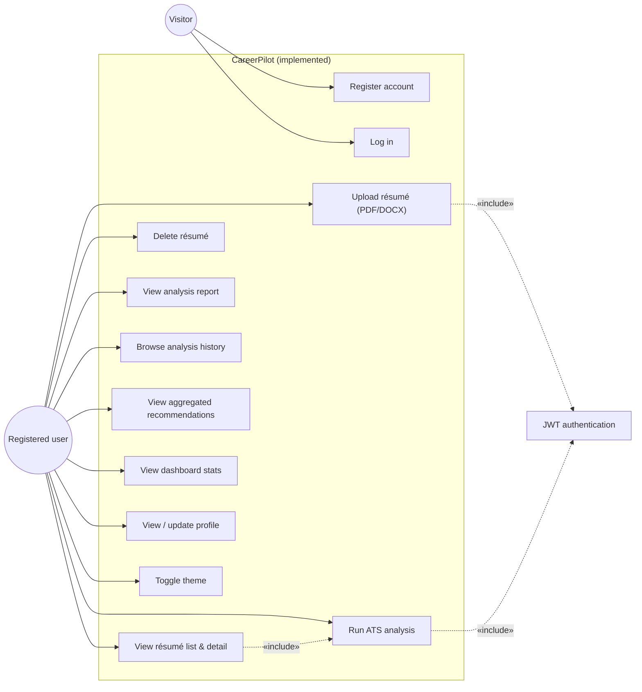

### 1.2 Proposed use cases (target)

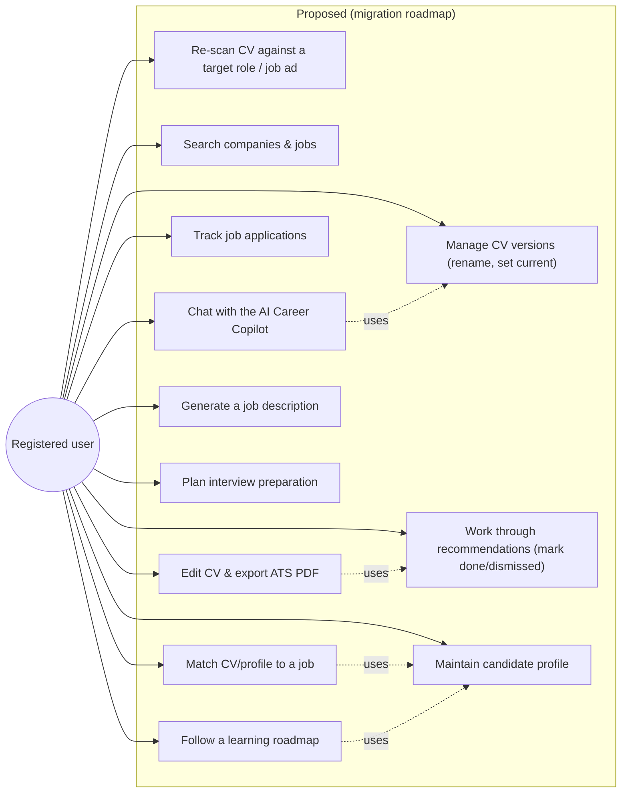

---

## 2. Class diagrams

### 2.1 Domain entities (implemented)

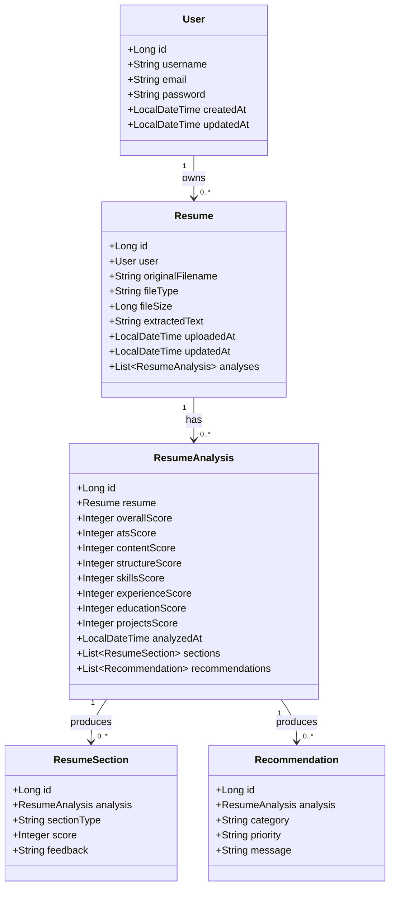

### 2.2 Supporting and engine classes (implemented)

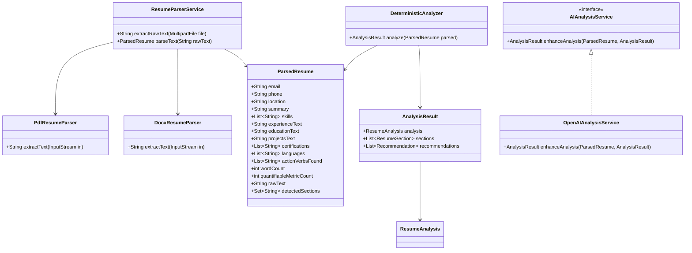

### 2.3 Proposed domain model (target — not implemented)

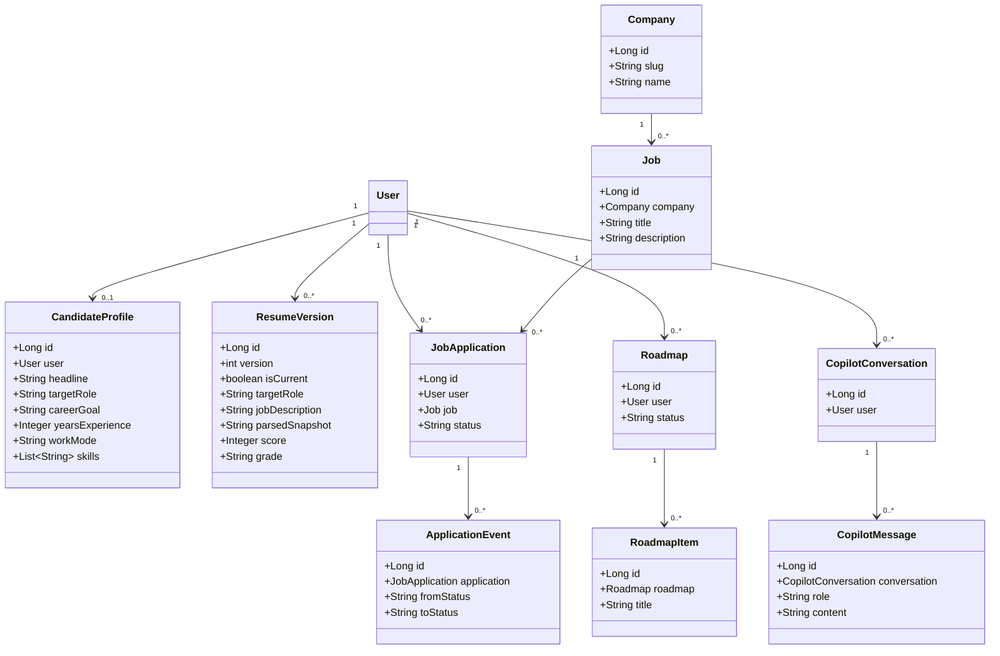

---

## 3. Sequence diagrams

### 3.1 Registration & login (implemented)

See [`ARCHITECTURE.md` §5](ARCHITECTURE.md#5-authentication-and-authorization) for the detailed
registration and JWT-validation sequences.

### 3.2 Upload → parse → analyse (implemented — the core ATS workflow)

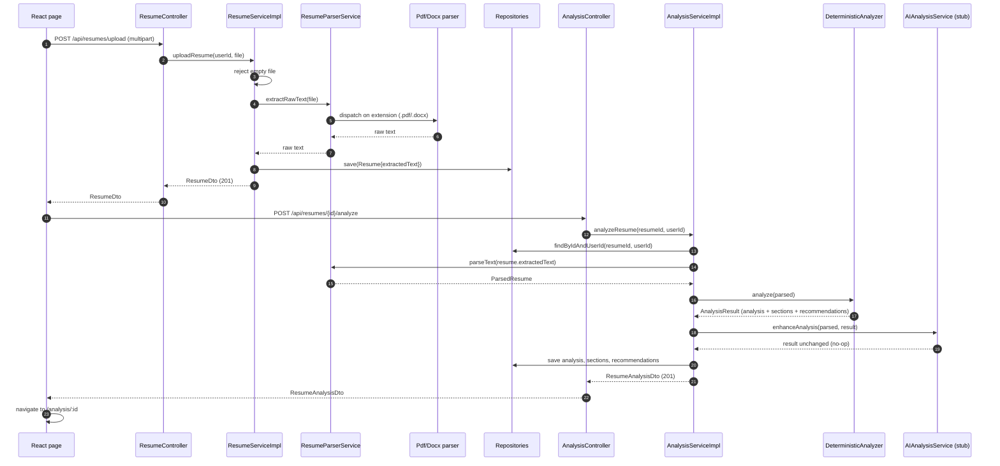

### 3.3 View dashboard (implemented)

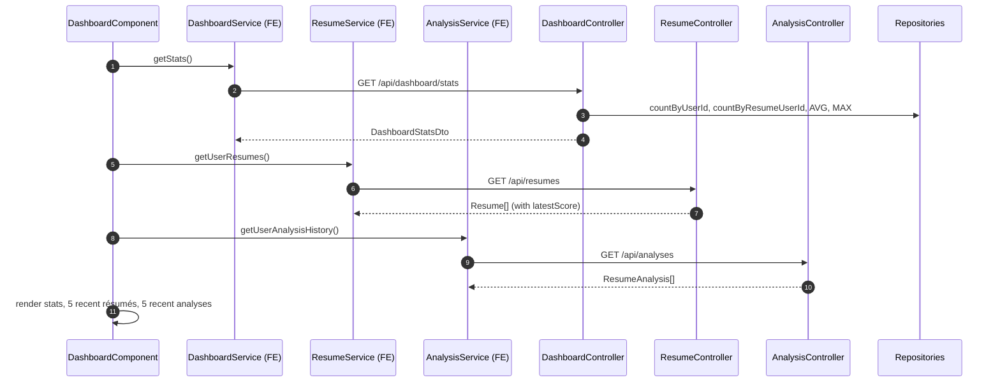

### 3.4 Proposed: CV re-scan with a target role (target)

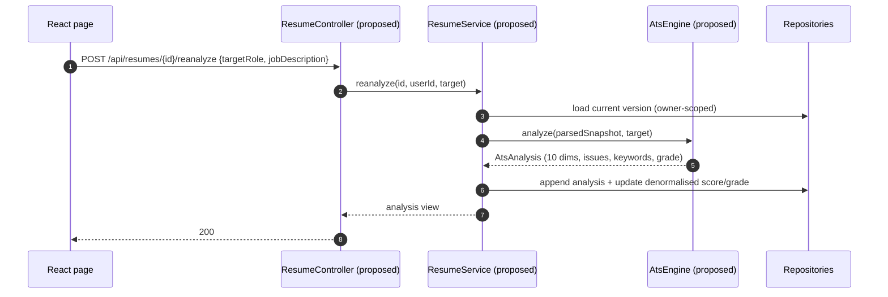

### 3.5 Proposed: grounded AI Career Copilot answer (target)

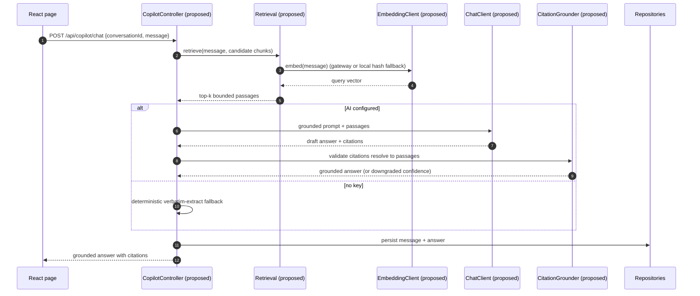

---

## 4. Activity diagrams

### 4.1 ATS analysis workflow (implemented)

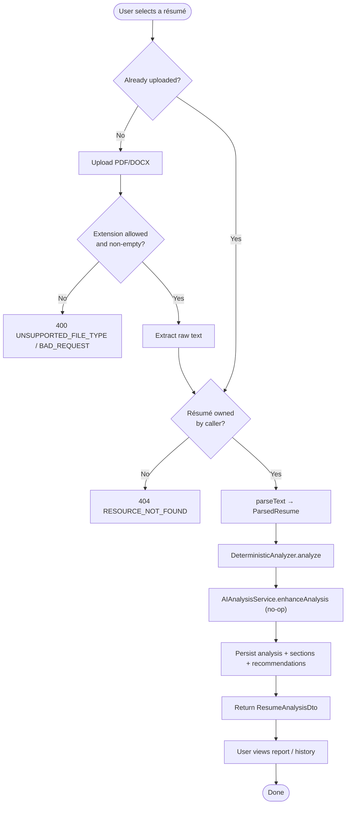

### 4.2 Authentication gate on every protected request (implemented)

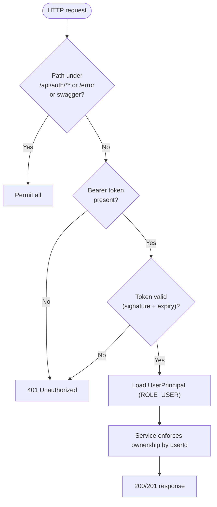

### 4.3 Proposed: roadmap generation with fallback (target)

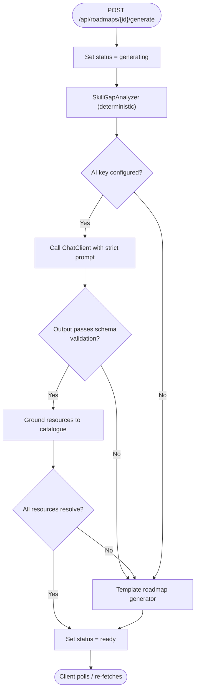

---

## 5. Component diagram (implemented)

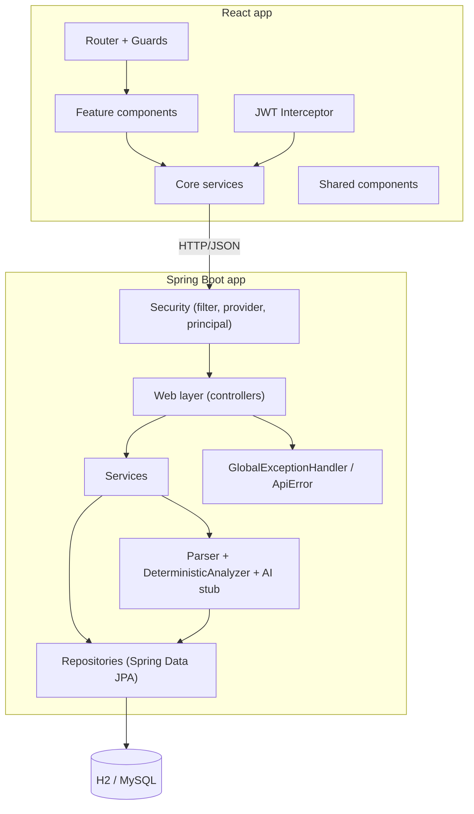

---

## 6. Deployment diagram

### 6.1 Implemented (local development + CI)

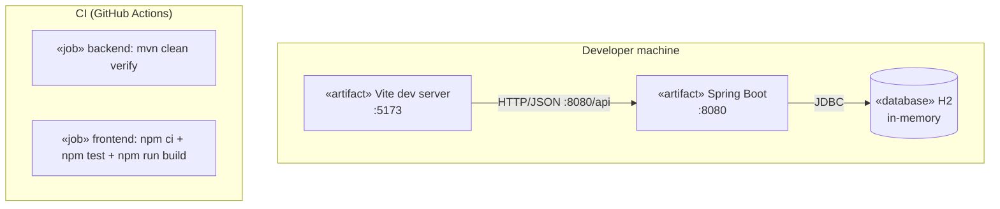

### 6.2 Implemented Docker Compose stack

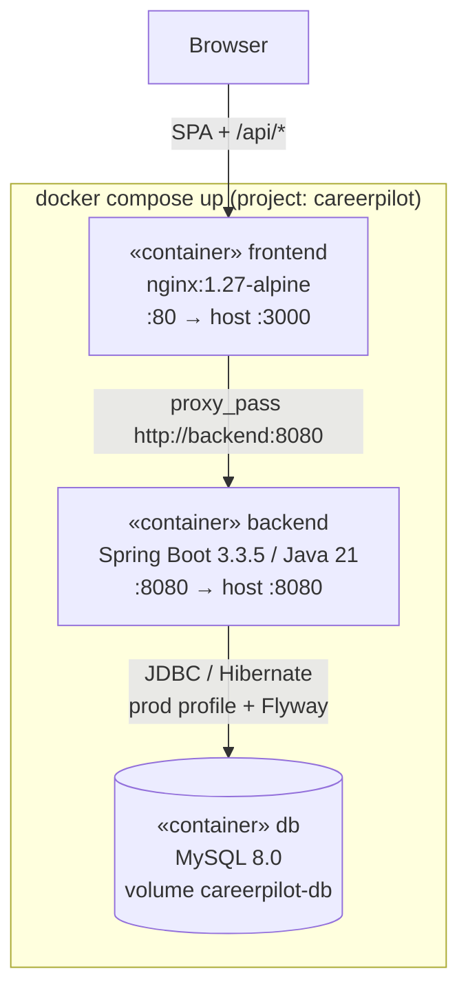

- The **frontend** image is a multi-stage build (`node:22-alpine` → `nginx:1.27-alpine`). nginx serves
  the SPA with history fallback, caches hashed assets, raises `client_max_body_size` to 10 MB and
  proxies `/api/` to `http://backend:8080`, so the browser uses one origin.
- The **backend** image is a multi-stage build (`maven:3.9-eclipse-temurin-21` →
  `eclipse-temurin:21-jre-alpine`). It runs the packaged jar as a non-root user with
  `SPRING_PROFILES_ACTIVE=prod`.
- The **db** service uses a named volume, a `mysqladmin ping` healthcheck and utf8mb4 settings. The
  backend waits for it to be healthy; the frontend waits for the backend healthcheck.
- Credentials and ports are overridable through the environment (see
  [`DEVELOPMENT.md`](DEVELOPMENT.md) §6.3).

> This stack is a local/self-hosted deployment reference, not a production hardening guarantee: TLS,
> secret management, managed backups and monitoring are still open items tracked in
> [`COMPLETION_CHECKLIST.md`](COMPLETION_CHECKLIST.md).
